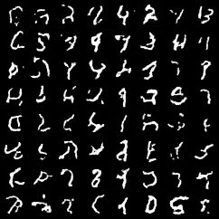
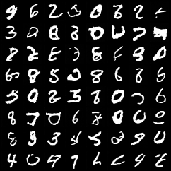

# مدل دیفیوژن (DDPM) روی دیتاست MNIST با PyTorch

پیاده‌سازی ساده‌ی **Denoising Diffusion Probabilistic Model** که از نویز خالص، ارقام دست‌نویس جدید تولید می‌کند.

## ⭐ نسخه‌ی Class-Conditional (انتخاب رقم دلخواه)

کد [diffusion_mnist.py](diffusion_mnist.py) اکنون **شرطی** است: می‌توانید رقم مورد نظر را مشخص کنید.

**روش:** برچسب رقم با یک `nn.Embedding` به embedding زمان اضافه می‌شود (۱۱ کلاس: ۱۰ رقم + یک توکن «بدون برچسب»). در آموزش، با احتمال ۱۰٪ برچسب حذف می‌شود تا مدل هر دو حالت شرطی و غیرشرطی را یاد بگیرد (**classifier-free guidance**). در نمونه‌گیری:
`ε = (1+w)·ε_cond − w·ε_uncond` که `w` همان `--guidance` است.

```bash
# آموزش (خروجی در outputs_cond/)
python diffusion_mnist.py --epochs 20

# تولید رقم دلخواه: ۱۰ تصویر از ۳ و ۱۰ تصویر از ۷ (هر ردیف یک رقم)
python diffusion_mnist.py --generate --digits 3 7 --n 10 --guidance 2.0
```

**نتیجه (۲۰ epoch، guidance=2):** loss نهایی ۰.۰۴۰۲. هر ستون یک رقم است (۰ تا ۹) و تمام ۱۰ ردیف هر ستون همان رقم را تولید کرده‌اند:


نمونه‌ی `--digits 3 7`:


### سنجش کمّی دقت برچسب‌ها

اسکریپت [evaluate_labels.py](evaluate_labels.py): یک CNN کوچک روی MNIST واقعی آموزش می‌بیند (۳ epoch، دقت تست **۹۹.۰٪**). سپس از مدل دیفیوژن برای هر رقم ۲۰۰ تصویر (جمعاً ۲۰۰۰) تولید و توسط classifier طبقه‌بندی می‌شود. دقت یعنی درصدی که رقم پیش‌بینی‌شده با رقم درخواست‌شده یکی است.

```bash
python evaluate_labels.py --n_per_class 200 --guidances 0 1 2 4
```

| guidance (w) | دقت برچسب |
|---|---|
| 0 (فقط شرطی، بدون guidance) | 79.85٪ |
| 1 | 98.55٪ |
| 2 (پیش‌فرض) | 99.55٪ |
| 4 | 99.95٪ |

دقت هر رقم برای w=0: `[0.83, 0.64, 0.74, 0.81, 0.89, 0.76, 0.93, 0.72, 0.90, 0.76]` (ضعیف‌ترین: رقم ۱ با ۶۴٪)؛ برای w=2 همه‌ی ارقام ≥ ۹۹٪. جزئیات در `outputs_cond/label_accuracy.json`.

**نکات:**
- guidance نقش تعیین‌کننده دارد: بدون آن حدود ۲۰٪ نمونه‌ها رقم اشتباه‌اند.
- این اعداد به دقت خود classifier (۹۹٪) و ۲۰۰ نمونه به‌ازای هر رقم وابسته‌اند؛ اختلاف‌های کوچک (مثلاً بین w=2 و w=4) معنادار نیست.
- w بزرگ‌تر کم‌تنوع‌تر می‌کند؛ این موضوع در بخش FID پایین اندازه‌گیری شده است.

### سنجش FID (کیفیت + تنوع)

اسکریپت [evaluate_fid.py](evaluate_fid.py): از هر رقم ۵۰۰ تصویر (جمعاً ۵۰۰۰) تولید و با ۱۰٬۰۰۰ تصویر تست واقعی MNIST مقایسه می‌شود (ویژگی‌های Inception-v3 با `torchmetrics` / `torch-fidelity`؛ تصاویر خاکستری به ۳ کانال و ۲۹۹×۲۹۹ تبدیل می‌شوند). FID کمتر = توزیع نزدیک‌تر به داده‌ی واقعی.

```bash
pip install torch-fidelity
python evaluate_fid.py --n_per_class 500 --guidances 0 1 2 4
```

| guidance (w) | FID ↓ | دقت برچسب ↑ |
|---|---|---|
| (مرجع: ۵۰۰۰ تصویر واقعی train در برابر test) | 2.14 | – |
| 0 | **26.95** | 79.85٪ |
| 1 | 32.86 | 98.55٪ |
| 2 | 45.25 | 99.55٪ |
| 4 | 71.44 | 99.95٪ |

**تفسیر:** یک trade-off روشن بین دقت برچسب و FID وجود دارد. با افزایش guidance دقت برچسب بالا می‌رود ولی FID بدتر می‌شود (۲۷ → ۷۱)، چون نمونه‌ها به «نمونه‌ی نوعی» هر رقم نزدیک می‌شوند و از توزیع واقعی کم‌تنوع‌تر می‌شوند. w=1 مصالحه‌ی خوبی است (دقت ≈ ۹۸.۶٪ با FID ۳۲.۹)؛ w=2 دقت بالاتر را با FID بدتر می‌خرد.

**محدودیت‌ها:**
- FID فقط یک عدد کلی برای «کیفیت و تنوع با هم» است و این دو را جدا نمی‌کند؛ بخشی از افزایش FID در w بزرگ می‌تواند از اشباع/آرتیفکت تصاویر باشد، نه فقط افت تنوع.
- Inception روی ImageNet آموزش دیده و FID روی MNIST استاندارد دقیقی ندارد؛ اعداد را فقط برای **مقایسه‌ی نسبی** همین مدل‌ها به‌کار ببرید، نه مقایسه با مقالات.
- با ۵۰۰۰ نمونه FID کمی بایاس مثبت دارد (به همین دلیل مرجع واقعی ۲.۱۴ و نه صفر است). فقط یک seed اجرا شده و بازه‌ی اطمینان محاسبه نشده است.
- اگر هدف تصاویر متنوع‌تر باشد، w=0 یا ۱ را انتخاب کنید؛ اگر هدف دقت برچسب باشد، w=2. پیش‌فرض کد (w=2) بر اساس دقت برچسب انتخاب شده است.

> بخش‌های زیر نتایج نسخه‌ی اولیه‌ی **بدون شرط** (پوشه‌ی `outputs/`) را شرح می‌دهند.

## ساختار پروژه

```
diffusion_mnist.py      کد کامل (مدل، فرایند دیفیوژن، آموزش، نمونه‌گیری)
train_log.txt           لاگ اجرای آموزش
outputs/
  model.pt              وزن‌های مدل آموزش‌دیده
  losses.csv            loss هر epoch
  loss_curve.png        نمودار loss
  sample_epoch{5,10,15,20}.png   نمونه‌های تولیدشده (شبکه 8x8)
data/                   دیتاست MNIST (دانلود خودکار)
```

## نصب و اجرا

```bash
pip install torch torchvision matplotlib
python diffusion_mnist.py --epochs 20
```

| آرگومان | پیش‌فرض | توضیح |
|---|---|---|
| `--epochs` | 10 | تعداد epoch |
| `--batch_size` | 128 | اندازه batch |
| `--lr` | 2e-4 | learning rate (Adam) |
| `--timesteps` | 300 | تعداد گام‌های دیفیوژن |
| `--out` | outputs | پوشه خروجی |

اگر GPU موجود باشد خودکار استفاده می‌شود.

## روش کار

1. **فرایند رو به جلو (Forward):** به تصویر اصلی `x0` در `T=300` گام، به‌تدریج نویز گاوسی اضافه می‌شود (جدول `beta` خطی از `1e-4` تا `0.02`). با فرمول بسته می‌توان مستقیم به هر گام `t` رفت:
   `x_t = sqrt(ᾱ_t)·x0 + sqrt(1-ᾱ_t)·ε`
2. **مدل:** یک U-Net کوچک (۱.۱۲ میلیون پارامتر) با time embedding سینوسی، GroupNorm، اتصال‌های skip و دو مرحله downsample/upsample (28→14→7). ورودی: تصویر نویزی و `t`؛ خروجی: نویز پیش‌بینی‌شده.
3. **آموزش:** در هر iteration یک `t` تصادفی انتخاب، تصویر نویزی ساخته و `MSE(ε_pred, ε)` کمینه می‌شود.
4. **نمونه‌گیری (Reverse):** از `x_T ~ N(0, I)` شروع و از `t=299` تا `0` گام‌به‌گام نویززدایی می‌شود.

## تنظیمات اجرای گزارش‌شده

| مورد | مقدار |
|---|---|
| دستگاه | GPU (CUDA) |
| پارامترهای مدل | 1.12M |
| Epoch | 20 |
| Batch size | 128 |
| Learning rate | 2e-4 (Adam) |
| Timesteps | 300 |
| داده | 60,000 تصویر آموزشی MNIST، نرمال‌شده به [-1, 1] |

## نتایج

### Loss آموزش

| Epoch | 1 | 2 | 5 | 10 | 15 | 20 |
|---|---|---|---|---|---|---|
| MSE loss | 0.1196 | 0.0625 | 0.0503 | 0.0446 | 0.0424 | 0.0410 |

loss در epoch های اول سریع افت می‌کند و بعد از epoch 10 تقریباً هم‌گرا می‌شود (کاهش کند). نمودار: `outputs/loss_curve.png`.

### کیفیت نمونه‌ها

| Epoch 5 | Epoch 20 |
|---|---|
|  |  |

- **Epoch 5:** شکل‌ها بیشتر خط‌خطی‌های شبیه رقم‌اند و اغلب قابل‌تشخیص نیستند.
- **Epoch 20:** بیشتر نمونه‌ها ارقام قابل‌تشخیص‌اند (0، 2، 3، 4، 6، 8، 9 و ...) با تنوع خوب در سبک نوشتار.

### محدودیت‌ها (صادقانه)

- بخشی از نمونه‌ها هنوز ناقص یا بدشکل‌اند (مثلاً ارقام مبهم یا خط‌های اضافه)؛ مدل کوچک است و فقط ۲۰ epoch آموزش دیده.
- فقط ارزیابی بصری انجام شده؛ معیار کمّی (FID یا دقت یک classifier روی نمونه‌ها) محاسبه نشده است.
- تولید **بدون شرط** است؛ نمی‌شود رقم دلخواه را انتخاب کرد.

## بهبودهای ممکن

- افزایش epoch (مثلاً 50–100) و استفاده از EMA روی وزن‌ها
- افزودن self-attention در لایه‌ی میانی U-Net
- cosine noise schedule
- سنجش جداگانه‌ی تنوع (مثلاً precision/recall) و آموزش طولانی‌تر برای FID بهتر
- نمونه‌گیری سریع‌تر با DDIM
- ارزیابی کمّی با FID
