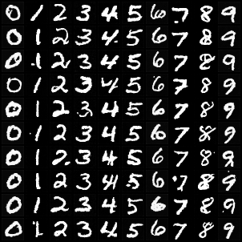
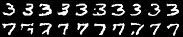

# Class-Conditional Diffusion Model (DDPM) on MNIST with PyTorch

A small implementation of a **Denoising Diffusion Probabilistic Model** that generates handwritten digits from pure noise. You can choose which digit to generate using **classifier-free guidance**. The model is evaluated with a classifier (label accuracy) and with FID.



*Generated samples after 20 epochs (guidance w=2). Each column is one digit, 0 to 9.*

## Project structure

```
diffusion_mnist.py      Model, diffusion process, training, conditional generation
evaluate_labels.py      Label accuracy of generated digits, measured with a CNN classifier
evaluate_fid.py         FID of generated digits vs. the real MNIST test set
outputs_cond/           Results of the class-conditional model
  loss_curve.png, losses.csv, sample_epoch*.png, generated_37.png
  label_accuracy.json, fid.json
outputs/                Samples and loss of the earlier unconditional baseline (see below)
data/                   MNIST (downloaded automatically, git-ignored)
```

Model weights (`model.pt`) are git-ignored. Re-create them with the training command below.

## Install and run

```bash
pip install torch torchvision matplotlib torch-fidelity   # torch-fidelity is only needed for FID

# Train (writes to outputs_cond/)
python diffusion_mnist.py --epochs 20

# Generate chosen digits: 10 images of "3" and 10 images of "7" (one row per digit)
python diffusion_mnist.py --generate --digits 3 7 --n 10 --guidance 2.0

# Evaluate
python evaluate_labels.py --n_per_class 200 --guidances 0 1 2 4
python evaluate_fid.py --n_per_class 500 --guidances 0 1 2 4
```

| Argument | Default | Description |
|---|---|---|
| `--epochs` | 10 | Number of training epochs |
| `--batch_size` | 128 | Batch size |
| `--lr` | 2e-4 | Learning rate (Adam) |
| `--timesteps` | 300 | Number of diffusion steps |
| `--p_uncond` | 0.1 | Probability of dropping the label during training |
| `--guidance` | 2.0 | Classifier-free guidance weight `w` |
| `--out` | outputs_cond | Output directory |
| `--generate` | off | Generate from a trained model instead of training |
| `--digits`, `--n` | 0-9, 10 | Digits to generate and images per digit (with `--generate`) |

A GPU is used automatically if available.

## How it works

1. **Forward process:** Gaussian noise is added to an image `x0` over `T=300` steps (linear beta schedule from `1e-4` to `0.02`). A closed form jumps straight to any step `t`:
   `x_t = sqrt(ᾱ_t)·x0 + sqrt(1-ᾱ_t)·ε`
2. **Model:** a small U-Net (1.12M parameters) with sinusoidal time embeddings, GroupNorm, skip connections and two down/up-sampling stages (28→14→7). Inputs: the noisy image, `t` and the class label. Output: the predicted noise.
3. **Class conditioning:** the digit label goes through an `nn.Embedding` (11 classes: 10 digits plus a "null" token) and is added to the time embedding. During training the label is replaced by the null token with probability 10%, so one network learns both the conditional and the unconditional noise prediction.
4. **Training:** for each batch, sample a random `t`, noise the image and minimize `MSE(ε_pred, ε)`.
5. **Sampling:** start from `x_T ~ N(0, I)` and denoise from `t=299` down to `0`, using classifier-free guidance:
   `ε = (1+w)·ε_cond − w·ε_uncond`

## Experimental setup

| Item | Value |
|---|---|
| Device | GPU (CUDA) |
| Model parameters | 1.12M |
| Epochs | 20 |
| Batch size | 128 |
| Learning rate | 2e-4 (Adam) |
| Timesteps | 300 |
| Data | 60,000 MNIST training images, normalized to [-1, 1] |

## Results

### Training loss

Final MSE loss of the conditional model after 20 epochs: **0.0402** (see `outputs_cond/loss_curve.png`).

### Sample quality

The grid at the top shows 10 samples per digit. Digits are clear and match the requested class. Example of `--digits 3 7`:



### Label accuracy

`evaluate_labels.py` trains a small CNN on real MNIST (3 epochs, **99.0%** test accuracy). It then classifies 200 generated images per digit (2,000 in total). Accuracy is the fraction of generated images whose predicted digit equals the requested digit.

| Guidance (w) | Label accuracy |
|---|---|
| 0 (conditional only, no guidance) | 79.85% |
| 1 | 98.55% |
| 2 (default) | 99.55% |
| 4 | 99.95% |

Per-digit accuracy at w=0 is `[0.83, 0.64, 0.74, 0.81, 0.89, 0.76, 0.93, 0.72, 0.90, 0.76]` (weakest: digit 1 at 64%). At w=2 every digit is at or above 99%. Full details are in `outputs_cond/label_accuracy.json`.

### FID (quality and diversity)

`evaluate_fid.py` generates 500 images per digit (5,000 in total) and compares them with the 10,000 real MNIST test images, using Inception-v3 features from `torchmetrics` / `torch-fidelity` (grayscale images are converted to 3 channels and resized to 299×299). Lower FID is better.

| Guidance (w) | FID ↓ | Label accuracy ↑ |
|---|---|---|
| Reference: 5,000 real train images vs. test set | 2.14 | – |
| 0 | **26.95** | 79.85% |
| 1 | 32.86 | 98.55% |
| 2 | 45.25 | 99.55% |
| 4 | 71.44 | 99.95% |

**Interpretation:** there is a clear trade-off. Higher guidance improves label accuracy but worsens FID (27 → 71), because samples move toward a "typical" example of each digit and become less diverse than the real distribution. w=1 is a good compromise (98.6% accuracy with FID 32.9). w=2 buys higher accuracy at the cost of a worse FID. Use w=0 or 1 for more diverse samples, and w=2 or higher when label correctness matters most. The code default (w=2) was chosen for label accuracy.

## Limitations

- FID is a single number for quality and diversity together. Part of the FID increase at large `w` may come from saturation or artifacts rather than lost diversity alone.
- Inception is trained on ImageNet and there is no standard FID protocol for MNIST. Use these numbers only for relative comparison between these runs, not against published results.
- With 5,000 generated samples FID has a small positive bias (hence the real-vs-real reference of 2.14, not 0). Only one seed was run and no confidence intervals were computed.
- Label accuracy depends on the classifier (99.0% on real data) and on 200 samples per digit. Small differences, for example between w=2 and w=4, are not meaningful.
- The model is small and trained for only 20 epochs. A few samples are still malformed or ambiguous.

## Unconditional baseline

The first version of this project was an unconditional DDPM with the same U-Net but without the label input. Its samples and loss curve are in `outputs/`. After 5 epochs the samples are mostly scribbles, and after 20 epochs (final loss 0.0410) most are recognizable digits. It could not be steered toward a chosen digit. That version is no longer in `diffusion_mnist.py`, and its weights are not included.

## Possible improvements

- Train longer (50–100 epochs) and use EMA on the weights
- Add self-attention in the middle of the U-Net
- Use a cosine noise schedule
- Faster sampling with DDIM
- Measure diversity separately from quality (for example precision/recall), and report FID over several seeds
